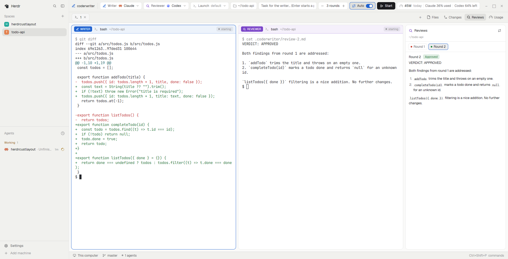

# coderwriter: a writer/reviewer agent pair layout for Herdr

Pair two coding agents in [Herdr](https://herdr.dev): a **writer** (Claude Code by default)
makes the change, a **reviewer** (Codex by default) reviews the uncommitted diff, and they
loop until the reviewer approves or a round limit is reached. Side panels show the review
rounds, token usage for both agents and Codex's plan limits, next to Herdr's Files and
Changes panels.



- Writer and reviewer side by side, each pane marked `WRITER` / `REVIEWER` with a live status.
- Review →, ← Feedback, or **Auto** for hands-off rounds (1–10, default 3).
- **Launch** flags per agent: skip permissions, permission modes, sandbox, web search or any
  flags of your own; empty means each agent's default. Optionally also used by the + menu.
- **Custom models**: any OpenAI-compatible endpoint that serves the Responses API
  (OpenRouter, OpenAI, Ollama, LM Studio, vLLM, LiteLLM, …) as writer or reviewer, run
  through Codex. A Test button checks the endpoint before you use it.
- **Reviews** panel: every round's verdict and findings, rendered.
- **Usage** panel: tokens per session and per day from the agents' local logs (custom models
  counted separately), plus each plan's limits where they apply: Claude's current session and
  weekly limits (all models and per model) as `/usage` shows them, and Codex's 5h and weekly
  limits as `/status` shows them. A bar chip shows `Claude 35% used · Codex 64% left`.
- **Files** panel with **New folder** (nested `a/b/c` too), **New file** and **Rename**, inline in
  the tree; it never overwrites an existing name.
- Herdr's spaces and agents sidebar, Changes panel and status bar.

## Install

Needs Herdr with Claude Code and/or Codex installed, and `python3` for the Usage panel.

```sh
git clone https://github.com/apache261/herdr-coderwriter
cd herdr-coderwriter
cp layouts/coderwriter.json layouts/coderwriter.svg ~/.config/herdr-app/layouts/
cp -r mods/coderwriter mods/coderwriter-tabs mods/coderwriter-pane mods/coderwriter-files ~/.config/herdr-app/mods/
herdr-app do layout.switch '{"name":"coderwriter"}'
```

If any of these names is already taken in your Herdr folder, rename the new one (its file or
folder, the `mod` names in the layout, and the `mods/<name>/` paths inside it) instead of
overwriting. `ctrl-shift-l` switches back to your previous layout; deleting the files
removes it.

## What it runs and reads

- Starts the agents and sends them messages with Herdr's `hc` (`hc run`, `hc send`, `hc wait`).
- Runs `sh` in the pair folder to list `.coderwriter/` and to add `.coderwriter/` to
  `.git/info/exclude`.
- The Usage panel runs `python3` to read `~/.claude/projects/**/*.jsonl` and
  `~/.codex/sessions/**/*.jsonl` (read only, files changed today or since the pair started),
  and, at most every 2 minutes, reads the live plan limits the way the agents do: Claude Code's
  `/usage` endpoint (`api.anthropic.com/api/oauth/usage`) with Claude Code's own sign-in from
  `~/.claude/.credentials.json` (macOS: the keychain), read only and never refreshed or sent
  anywhere else; and `codex app-server`, which contacts OpenAI as Codex's `/status` does.
  Each is skipped when that agent isn't installed or isn't signed in with a plan.
- The Files panel runs `sh` (`mkdir -p`, `mv`, creating an empty file) only when you create or
  rename something, in the folder you're browsing.
- Writes `~/.config/herdr-app/programs.json` only if you check "Also use these flags for the
  tab bar's + menu".
- Custom models: **Test** sends `GET <base>/models` and one tiny `POST <base>/responses`
  (and `/chat/completions` if that fails) to the endpoint you enter. A pasted API key is
  saved only in `~/.config/coderwriter/keys/<id>.key` (folder 700, file 600), never in Herdr's
  shared state, the layout or a command line; an environment-variable key is read from
  Herdr's environment or, if missing there, from your interactive shell.

See [RECIPE.md](RECIPE.md) for the full description, the build notes and what "done" looks like.
