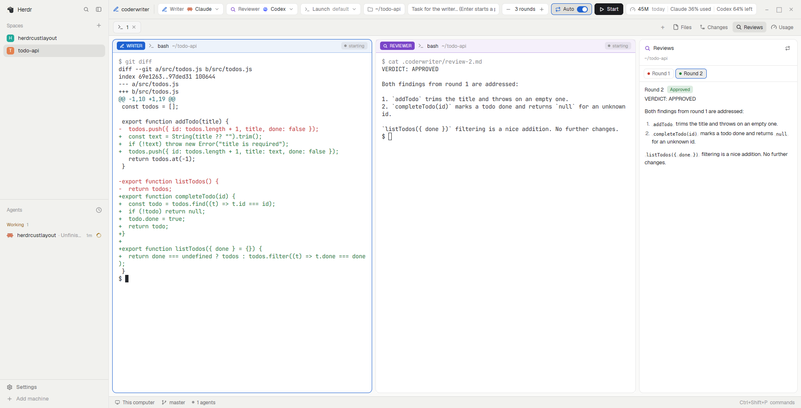

# coderwriter: coding agents that work as a pair or a team, in Herdr

A layout and mods for [Herdr](https://herdr.dev) that make coding agents check each other's
work before you see it.

- **Pair**: a **writer** makes the change, a **reviewer** reviews the uncommitted diff, and
  they loop until the reviewer approves or a round limit is reached.
- **Team** (preview): you give the task to a **PM**, which plans it with you. Then, subtask by
  subtask, a **Coder** writes, a **Tester** writes and runs the tests, and a **Reviewer** checks
  quality and security, round after round, until every check passes. The PM writes a report
  at the end.

Nothing is ever committed: the work stays uncommitted for you to review and commit.



## Pair

- Writer and reviewer side by side, each pane marked `WRITER` / `REVIEWER` with a live status.
- **Review →**, **← Feedback**, or **Auto** for hands-off rounds (1–10, default 3).
- **Test gate**: a test command per folder (`npm test`, `pytest -q`, …) runs before every
  review. A failure goes back to the writer instead of the reviewer; Auto tries 3 times, then
  pauses.
- **Ponytail review** (optional): the reviewer follows
  [Ponytail](https://github.com/DietrichGebert/ponytail)'s `ponytail-review` skill each round
  (correct, safe, holds under load, tested, fast, lean), keeping the verdict format.

## Team (preview)

```
You ─task─▶ PM ─(asks you if unclear)─▶ plan ─▶ you approve
              for each subtask:  Coder ─▶ Tester ─▶ Tests ─▶ Quality ─▶ Security
                                   ▲                                       │
                                   └────── every failure, in one note ◀────┘
              all subtasks pass ─▶ PM's report ─▶ offer of a full audit
```

- **PM** reads the repository, asks you what's unclear in its pane, and writes
  `.coderwriter/plan.md`: subtasks with *Do*, *Done when* and *Tests*. The Plan dialog shows
  it: ask the PM for changes, or **Approve & start**. The PM plans and reports; coderwriter
  itself does the hand-offs, so a confused agent can't derail them.
- **Every check runs every round**, even when one fails, and all failures go to the coder in
  one note (`.coderwriter/review-<n>.md`):
  - **Tester**: writes or updates unit and functional tests in the project's own framework,
    runs them and the suite, and reports what it wrote, what it ran, and each failure.
  - **Tests**: your test command, if set (it includes the tester's new tests).
  - **Quality**: the reviewer, following Ponytail's review when installed.
  - **Security**: the reviewer, on this change only (injection, path traversal, XSS, auth,
    secrets, SSRF, CSRF, crypto, dependencies, data exposure), real issues only, using the
    principles of Cloudflare's skill when installed.
- **Test files are the tester's**: files are snapshotted after the tester runs, and a coder
  that edits a test gets it back as a finding (the tester is told to check it).
- **On screen**: the team's tab is a 2×2 grid in the order the work flows (PM over Coder,
  Tester over Reviewer); the bar shows the flow as a strip (`2/3 PM › Coder › Tester › Tests ›
  Quality › Security`: working, passed, failed or waiting on you); the Reviews panel shows
  each round's summary, the coder's notes, every check's own report, and the PM's plan and
  report.

## Both

- **Starting**: in a tab without a pair, the bar shows **New pair…** and **New team…**; the tab
  bar's **+** menu has them too, plus **Terminal** and Herdr's own menu. One dialog holds
  every setting: the task, an agent per role, the folder, rounds, Team, Ponytail, Auto,
  **Launch flags…** and **Custom models…**.
- **The bar follows the shown tab**: in a pair's or team's tab it shows only that one's
  status and **Review**, **Feedback**, **Plan**, **Audit**, **Auto**, **Stop**.
- **Any agent per role**: any agent Herdr knows and finds installed (Claude Code, Codex,
  Copilot, …), a custom model, or **Command**: a command line of your own, for instance the
  same model at another effort:

  | Role | Command |
  |---|---|
  | PM | `claude --model opus --effort high` |
  | Coder | `claude --model opus --effort medium` |
  | Reviewer | `codex --no-daemon -m gpt-5 -c model_reasoning_effort=high` |

  A command replaces the launch flags, so add the ones you want. Use agents Herdr shows a
  status for: coderwriter waits for each turn to end by it.
- **Audits after approval**: when the work is approved, a dialog asks whether the reviewer
  should also run Cloudflare's [security audit](https://github.com/cloudflare/security-audit-skill)
  and/or Ponytail's code audit (`ponytail-audit`) over the repository; nothing is checked by
  default. The audit is one more round, so Feedback sends its findings to the writer.
  **Audit** in the bar asks again any time. A skill that isn't installed is shown with its
  install command; coderwriter installs nothing.
- **Round snapshots**: the files are saved at the start and at every review, so the reviewer
  can check just what changed since its last round, and the Reviews panel can put the files
  back to any round (undoable).
- **Stuck-loop detection**: a finding that comes back unchanged from the round before pauses
  Auto, and Feedback sends it back with a nudge.
- **Launch flags** per agent: skip permissions, permission modes, sandbox, web search or any
  flags of your own; empty means each agent's default. Optionally also used by the + menu.
- **Custom models**: any OpenAI-compatible endpoint that serves the Responses API
  (OpenRouter, OpenAI, Ollama, LM Studio, vLLM, llama.cpp, LiteLLM, …) in any role, run
  through Codex via a small local relay that folds Codex's several system messages into one
  (some chat templates, such as Gemma's in llama.cpp, accept only one). A Test button checks
  the endpoint before you use it.
- **Reviews** panel: every round's verdict and findings, rendered (and a team's per-check
  reports, plan and report).
- **Usage** panel: tokens per session and per day from the agents' local logs (custom models
  counted separately), plus each plan's limits where they apply: Claude's current session and
  weekly limits (all models and per model) as `/usage` shows them, and Codex's 5h and weekly
  limits as `/status` shows them.
- **Files** panel with **New folder** (nested `a/b/c` too), **New file** and **Rename**, inline in
  the tree; it never overwrites an existing name. Files and folders are colored by git
  state: modified, staged, new, deleted, conflicted, committed but not pushed, and ignored
  (dimmed), with a key under the tree.
- Herdr's spaces and agents sidebar, Changes panel and status bar.

## Install

Needs Herdr with Claude Code and/or Codex (or another agent Herdr knows) installed, and
`python3` for the Usage panel. Optional: [Ponytail](https://github.com/DietrichGebert/ponytail)
for the quality review and code audit, and Cloudflare's
[security-audit skill](https://github.com/cloudflare/security-audit-skill) for the security
audit.

```sh
git clone https://github.com/apache261/herdr-coderwriter
cd herdr-coderwriter
cp layouts/coderwriter.json layouts/coderwriter.svg ~/.config/herdr-app/layouts/
cp -r mods/coderwriter mods/coderwriter-tabs mods/coderwriter-pane mods/coderwriter-files ~/.config/herdr-app/mods/
herdr-app do layout.switch '{"name":"coderwriter"}'
```

If any of these names is already taken in your Herdr folder, rename the new one (its file or
folder, the `mod` names in the layout, and the `mods/<name>/` paths inside it) instead of
overwriting. `ctrl-shift-l` switches back to your previous layout; deleting the files
removes it.

Keys (optional, in `~/.config/herdr-app/keys.json`): `coderwriter.new` (the dialog),
`coderwriter.team` (Team on or off for the next one), `coderwriter.review`,
`coderwriter.feedback`, `coderwriter.auto`, `coderwriter.stop`, `coderwriter.show-plan`,
`coderwriter.show-audit`.

## What it writes

Everything goes in `.coderwriter/` in the pair's folder, which is added to the repo's
`.git/info/exclude` so it stays out of the diff:

| File | What |
|---|---|
| `review-<n>.md` | round n: the verdict and findings (for a team, every check's failures in one note) |
| `tests-<n>.txt` | the test command's output in round n |
| `round-<n>/<check>.md` | a team's per-check reports: `tester`, `quality`, `security`, and the coder's notes `coder.md` |
| `coder.md` | the team coder's latest notes on what it changed |
| `plan.md`, `report.md` | the team PM's plan and final report |
| `security-audit/` | the security audit's working files |

## What it runs and reads

- Starts the agents and sends them messages with Herdr's `hc` (`hc run`, `hc send`, `hc wait`),
  and places a team's panes with Herdr's `terminal.keep` and `pane.swap`.
- Runs `sh` in the pair folder to list `.coderwriter/`, to add `.coderwriter/` to
  `.git/info/exclude`, and to write a team round's combined `review-<n>.md`.
- The Usage panel runs `python3` to read `~/.claude/projects/**/*.jsonl` and
  `~/.codex/sessions/**/*.jsonl` (read only, files changed today or since the pair started),
  and, at most every 2 minutes, reads the live plan limits the way the agents do: Claude Code's
  `/usage` endpoint (`api.anthropic.com/api/oauth/usage`) with Claude Code's own sign-in from
  `~/.claude/.credentials.json` (macOS: the keychain), read only and never refreshed or sent
  anywhere else; and `codex app-server`, which contacts OpenAI as Codex's `/status` does.
  Each is skipped when that agent isn't installed or isn't signed in with a plan.
- Test gate: runs your test command with `sh -c` in the pair folder before each review (10
  minute limit), output to `.coderwriter/tests-<round>.txt`.
- Round snapshots: commits made with `git commit-tree` from a temporary index (your staging is
  untouched), kept only under `refs/coderwriter/<pair>/`, never on a branch, and deleted when
  the pair's tab closes. Restoring rewrites the working tree from one (after saving the current
  files as `before-restore`, for Undo); outside a git repo there are no snapshots.
- Ponytail and Cloudflare skills: runs `sh` to look for each skill's `SKILL.md` in the pair
  folder's `.claude/skills`, `.agents/skills`, `.codex/skills`, the same under your home
  folder, and Claude Code's and Codex's plugin caches; the reviewer is told that file's path.
- The Files panel runs `sh` (`mkdir -p`, `mv`, creating an empty file) only when you create or
  rename something, in the folder you're browsing.
- Writes `~/.config/herdr-app/programs.json` only if you check "Also use these flags for the
  tab bar's + menu".
- Custom models: **Test** sends `GET <base>/models` and one tiny `POST <base>/responses`
  (and `/chat/completions` if that fails) to the endpoint you enter. A pasted API key is
  saved only in `~/.config/coderwriter/keys/<id>.key` (folder 700, file 600), never in Herdr's
  shared state, the layout or a command line; an environment-variable key is read from
  Herdr's environment or, if missing there, from your interactive shell. Each custom-model agent
  runs `python3` as a relay on `127.0.0.1` (a free port) that lives as long as the agent.

See [RECIPE.md](RECIPE.md) for the full description, the build notes and what "done" looks like.
