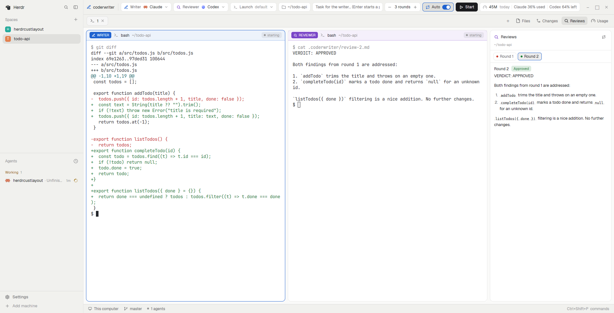

# coderwriter

A Herdr layout for running two coding agents as a pair: a **writer** (Claude Code by
default) makes the change and a **reviewer** (Codex by default) reviews the uncommitted
diff, round after round, until it approves or a round limit is reached. Either side can also be a
custom model on any OpenAI-compatible endpoint, run through Codex. A bar above the
panes sets up and drives the pair, each pane's header says which role it plays, and side
panels show the review rounds, the token usage of both agents and Codex's plan limits,
next to Herdr's own Files and Changes panels. The spaces and agents sidebar stays on the
left.

## What you see

Left to right, top to bottom (sizes at zoom 1, colors are theme names so it follows light
and dark themes):

- **Sidebar**, 260 px, `chrome` background, 1 px `border` divider on its right. Herdr's
  `workspace-chrome` header (42 px: logo, search, collapse), then `spaces` and `agents`
  sharing the height equally (90 px minimum each), then the `workspace-chrome` footer
  (69 px: Settings, Add machine). Folding it narrows it to a 44 px rail.
- **Tab bar**, 42 px, drags the window. Tabs as pills, `+` (new terminal or agent), then
  four panel toggles: **Files**, **Changes**, **Reviews**, **Usage** (the open one gets the
  `selected` background), then window buttons where the system draws none. When the
  sidebar is hidden, a sidebar button appears at its left edge.
- **coderwriter bar**, 46 px, `chrome` background, bottom border. Left to right:
  - pen icon (`ansi4`) and **coderwriter** in semibold 12.8 px;
  - **Writer** chip (pen, `ansi4`) and **Reviewer** chip (magnifier, `ansi5`), each with
    the agent's icon and name and a chevron; a click opens a 250 px popup listing Claude
    Code, Codex and your custom models (a chip icon in `accent`; not installed ones dimmed,
    custom models say "needs Codex" without it; a check on the chosen one), then a divider and
    **Custom models…**;
  - **Launch** chip: `default`, or which agents have extra flags (`Claude flags`); red
    border, red tint and a warning icon while a permission-skipping flag is on;
  - folder chip: the folder new pairs start in (follows the focused pane until picked,
    then shows an `x` to go back to following);
  - task input (fills the remaining width, accent border while focused);
  - rounds stepper `– 3 rounds +` (1 to 10) and an **Auto** switch;
  - **Start** (solid, play icon);
  - usage chip: gauge icon, today's tokens (`29M today`) and `Codex 64% left`, red when 20 %
    or less is left.
  - In a pair's tab the stepper and switch move into a pair group after a separator:
    spinner while a job runs, the pair's note ("Round 2: reviewing"), a verdict pill
    (Approved / Changes requested / No review file / No verdict), `round/max`, **Review →**,
    **← Feedback**, **Auto**, **Stop**.
- **Panes**, 8 px padding and gap, cards with 10 px radius, 1 px `border` (accent when
  focused), framed even when alone. Each has a 32 px header: a writer or reviewer pane gets a
  solid role chip (`WRITER` in `ansi4` / `REVIEWER` in `ansi5`), a header tinted with that
  color (8 % background, 40 % border), the program and folder, `round n/max`, and a status
  badge (`starting`, `working` with a spinner, `needs you`, `done`, `idle`). Other panes look
  like Herdr's own header. Split, zoom and close buttons appear on hover.
- **Side panel**, 380 px (280–900, resizable), hidden until a toggle opens it. A stack of
  four:
  - **Files**: Herdr's file browser for the focused pane's folder, plus creating and
    renaming. The header has New file and New folder (for the folder shown); hovering a row
    shows New file / New folder (folders) and Rename, 20 px icon buttons that replace the
    git mark while hovered. Editing happens in the tree: a 28 px row on the `selected`
    background with an inline input (accent border, `blocked` when there's an error, the error
    on the line below); Rename preselects the name without its extension.
  - **Changes**: Herdr's own panel.
  - **Reviews**: the reviewer's rounds for this pair (or the focused folder): writer →
    reviewer and `round n/max`, the pair's note, one chip per round with a green (approved)
    or red (changes requested) dot, then the selected round's review rendered as Markdown,
    selectable and scrolling. Empty states say what to do next.
  - **Usage**: tokens from the agents' local logs. *This pair* (since it started) or *this
    folder* (today): a card per session with agent, role chip, model, total, context size
    (`26k / 475k context` for Codex), last activity, and a stacked bar of input / cache read
    / cache write / output (`ansi4` / `ansi6` / `ansi3` / `ansi5`). *Today, all folders*: a
    card each for Claude Code and Codex. Custom models get their own cards
    (chip icon, their name, `model · no plan limits`). *Codex plan limits · PLUS*: the 5h and
    weekly limits as `% left` with a bar (accent, `ansi3` at 30 % or less, `blocked` at 10 % or less) and
    `resets 14:42` / `resets 18:55 on 17 Nov`, marked `live` or `from logs`; "Not available"
    when Codex isn't signed in with a ChatGPT plan, and a note that custom models don't count
    against these.
- **Custom models dialog**, 600×640, centered. A list of models (name, a writer/reviewer tag
  when in use, `model · host · $ENV_VAR | saved key | no key`, Edit, Delete) with Close and
  **Add model**. The editor: provider presets (OpenRouter, OpenAI, Ollama, LM Studio,
  LiteLLM, vLLM: fill the base URL and key mode), Base URL, Model (after a Test, the
  endpoint's model ids show as chips to pick, filtered by what's typed), Name, API key mode
  (Environment variable / Paste key (masked) / No key (local)), the Test result (one dot per
  check: green, red, grey), and Test / Save, with what's missing written beside them.
- **Status bar**, 28 px: Herdr's `workspace-status` (machine, branch, agents, palette key).

## How it behaves

- **Start** (or Enter in the task input) starts a pair: a new tab in the shown space with the
  writer on the left and the reviewer on the right, both in the chosen folder. With a task,
  the writer gets it at once (with a note that it is the WRITER and should leave changes
  uncommitted); without one, you type into the writer yourself. `.coderwriter/` is added to
  the repo's `.git/info/exclude` so reviews stay out of the diff.
- **Review →** waits for the writer to finish its turn, then asks the reviewer to review the
  uncommitted changes (`git status`, `git diff`, untracked files) and write
  `.coderwriter/review-<n>.md`, first line `VERDICT: APPROVED` or
  `VERDICT: CHANGES_REQUESTED`, then numbered findings. **← Feedback** asks the writer to
  address the latest review.
- **Auto** loops review → feedback until the reviewer approves (success toast that selects
  the tab), a review has no verdict line (warning, loop pauses), or the round limit is reached
  (warning). The limit only stops Auto; Review and Feedback by hand can go past it.
  **Stop** ends the running job and turns Auto off. A Herdr reload pauses running pairs and
  says so.
- Agent statuses drive the flow and the pane badges: `working` is waited out, `blocked`
  ("needs you") waits for you to answer the agent, `idle` and `done` let the next step go.
  An agent that exits stops the job with an error toast.
- **Launch** opens a 470×486 popup with a section per agent:
  - preset toggles: Claude Code: Skip permissions (`--dangerously-skip-permissions`),
    Accept edits, Auto mode, Plan mode (`--permission-mode …`, one at a time). Codex:
    Bypass approvals + sandbox (`--dangerously-bypass-approvals-and-sandbox`),
    Auto-approve (`--approve-for-me`), Workspace write / Read-only (`--sandbox …`), one at a
    time, plus Web search (`--search`);
  - a text field for any other flags (shell-style quoting), a preview of the exact command
    (`$ codex --no-daemon --search`), **Reset to default**, and a red warning while a
    permission-skipping flag is on;
  - **Also use these flags for the tab bar's + menu**: writes the command as that agent's
    `run` in `programs.json`, and removes it again when unchecked or cleared (only a `run`
    it wrote itself).
  Empty flags (the default) start the agents exactly as Herdr does: `claude` and
  `codex --no-daemon`.
- **Custom models**: Codex is started with
  `-c model_providers.cw_<id>.{name,base_url,wire_api="responses",env_key}`,
  `-c model_provider="cw_<id>"` and `-m <model>`, plus Codex's launch flags. A key goes in
  through the environment only: a small `sh` loader reads the saved key file, or takes the
  variable from Herdr's environment and, when it isn't there, from `$SHELL -ic`, then
  `exec`s Codex; it says on stderr when the key is missing. **Test** reports: the key found or
  not, `GET /models` (count, whether the model id is listed), `POST /responses` (works: "Codex
  can use this model"), and when that fails `POST /chat/completions` ("Only Chat Completions
  works here", with what to do). Deleting a model removes its key file and puts writer or
  reviewer back to Claude / Codex if it was chosen.
- **Usage** refreshes when shown and every 15 s; the bar's chip every 30 s. Codex's live
  limits are asked of Codex at most every 2 minutes (the refresh button forces it); between
  those, or when that fails, the latest limits recorded in Codex's logs are used.
- **Reviews** re-reads `.coderwriter/` every 5 s; clicking a round chip shows it.
- Files: Enter creates or renames, Esc or clicking away cancels. New folder accepts `a/b/c`
  (made at once); file names and renames can't contain `/`; `.`, `..` and empty parts are
  refused. An existing name is never replaced: the error says "<name> already exists". A
  new entry's folder opens; a renamed open folder stays open, and a previewed file follows
  its new name.
- Panel toggles open the panel on that view, or close it if it is already showing; the
  choice is remembered per space.
- Keys (optional, add to `keys.json`): `coderwriter.start`, `coderwriter.task` (focus the
  task input), `coderwriter.review`, `coderwriter.feedback`, `coderwriter.auto`,
  `coderwriter.stop`.

## Built from

- `layouts/coderwriter.json`: root `row` (`titlebar: none`, `canvas` background, terminal
  padding 14×12) → `sidebar` column (`brand`, `sidebar-lists` with `spaces` + `agents`,
  `sidebar-footer`) and `work` column → `tabs` (`coderwriter-tabs`), `cw-bar`
  (`coderwriter`, props `{role: "bar"}`), `work-body` row (`main`: `{tab: "active"}` with the
  pane frame and `coderwriter-pane` header; `panel` column → `panel-body` stack of `files`
  (`coderwriter-files`),
  `changes`, `reviews` (`coderwriter` `{role: "reviews"}`), `usage` (`coderwriter`
  `{role: "usage"}`)), `status` (`workspace-status`). Preview: `layouts/coderwriter.svg`.
- `mods/coderwriter/`: one mod with roles: `bar` (`main.js`), `pick` (agent popup), `launch`
  (`launch.js`), `models` (`models.js` + `probe.py`; props `{new?, edit?}`), `reviews`
  (`reviews.js`), `usage` (`usage.js` + `usage.py`). `pair.js` is
  the engine; pairs live in shared `coderwriter.pairs` keyed by tab, preferences in
  `coderwriter.prefs` (writer, reviewer, max, auto, flags, menu, models: `{id, name,
  base_url, model, key: "env"|"file"|"none", env}`; a custom model's agent key is
  `m:<id>`), usage in
  `coderwriter.usage`.
- `mods/coderwriter-tabs/`: a clone of Herdr's `tabs` that always offers the panels the
  layout has and a show-sidebar button.
- `mods/coderwriter-pane/`: a clone of Herdr's `pane` header with role chips and badges.
- `mods/coderwriter-files/`: a clone of Herdr's `files` with create and rename; operations
  are `sh -c` scripts (`cd`, an exists check, then `mkdir -p --`, `set -C; : >`, `mv --`) run
  with the panel's `on`, so they work on a space's other machine.
- Shipped mods used as they are: `workspace-chrome`, `spaces`, `agents`, `changes`,
  `workspace-status`, `new-menu`, `menu`.
- `herdr`: `spaces`, `panes`, `focused`, `terminals`, `knownAgents`, `shared`/`setShared`,
  `openOverlay`/`closeOverlay`, `pickFolder`, `notify`, `exec`, `readTextFile`,
  `writeTextFile`, `appHome`, `layout`, `nextCommand`; commands `tab.rename`,
  `tab.select`, `layout.show`/`hide`/`select`, `pane.split`/`zoom`/`close`/`focus`.
- Programs run: `hc run` (start the agents with labels `herdr.space`, `herdr.tab`,
  `coderwriter.role`, `coderwriter.pair`), `hc send --wait`, `hc wait`; `sh` (the git
  exclude line, listing `.coderwriter/`); `sleep`; `python3` (`usage.py`); `codex
  app-server` (started by `usage.py` for `account/rateLimits/read`); `python3` (`probe.py`,
  the endpoint test); `chmod`, `rm` (key files).
- Files read outside the mod: the pair folder's `.coderwriter/review-*.md`,
  `~/.claude/projects/**/*.jsonl` and `~/.codex/sessions/**/*.jsonl` (only files changed
  since midnight or since the pair started). Files written: the pair folder's
  `.git/info/exclude`, `programs.json` only when the + menu option is checked, and
  `~/.config/coderwriter/keys/<id>.key` for a pasted key.
- Network: the endpoint test calls the base URL you enter (`/models`, one tiny `/responses`,
  maybe `/chat/completions`); Codex's own app-server contacts OpenAI to read the limits, as
  `/status` does. Nothing else.
- Icons: Lucide-style 24×24 stroke SVGs in `mods/coderwriter/icons/`.

## Watch out

- Clone, don't edit, Herdr's `tabs` and `pane`: shipped mods are replaced on every start.
- The shipped tab bar shows Files/Changes only if the welcome screen's panel choice
  (`workspace.panels`) lists them, and that choice is often `[]`; `coderwriter-tabs`
  ignores it and offers what `panel-body` contains.
- Claude Code writes one log line per content block, each with the message's usage: dedupe
  by message id + request id, or totals come out several times too high. Subagent logs live
  in subfolders and carry the parent's `sessionId`.
- Codex's `total_token_usage` is cumulative per session: today's share is the last total
  minus the last total before midnight. Its `input_tokens` include the cached ones.
- Codex's `/status` shows **% left**, the logs and API give **% used**; show what `/status`
  shows. Log limits are only as fresh as the last Codex turn; ask the app-server
  (`initialize`, `initialized`, then `account/rateLimits/read` over stdio JSON-RPC) for live
  ones. Claude Code's plan limits are not in its local logs.
- Herdr's `prompt` dialog hands its text to an app command, not back to a panel, so the
  Files panel edits names inline; an `InputState` blur cancels, so focus it again after the
  row appears (`cx.timer.after`). On local Windows, create/rename is off (no `sh`).
- Codex removed `wire_api = "chat"`: it only reaches providers through the Responses API
  (`<base>/responses`). Chat-Completions-only endpoints need a proxy (LiteLLM) in front; the
  Test says so instead of letting a pair fail.
- Keep API keys out of argv, labels and shared state: they'd show in `hc ls`, process lists
  and `shared.json`. Herdr-core's environment often lacks variables exported in shell rc
  files, hence the `$SHELL -ic` fallback (works for bash, zsh and fish).
- Codex logs record `model_provider` per session: split usage by it, and only take plan
  limits from `openai` sessions.
- `usage.py` is passed to `python3 -c` (read with `readTextFile`) so it also runs on a
  space's other machine; it needs `python3` there.
- The mods' JS has no `setTimeout` and `toLocaleString` ignores options: format dates by
  hand. `TextView.markdown` goes inside a scrolling `div`, not `.scrollable(true)` in a
  flex column.
- Writer and reviewer can be the same program (Claude + Claude), but then the Usage panel
  can't label their sessions WRITER / REVIEWER.
- Totals include cached input, which most plans bill at a discount.
- The layout assumes Claude Code and Codex; other agents aren't offered as writer/reviewer.

## Done when

- `herdr-app check` passes for `mods/coderwriter`, `mods/coderwriter-tabs` and
  `mods/coderwriter-pane`, and `herdr-app status` shows no errors after
  `layout.switch {"name": "coderwriter"}`.
- The sidebar shows spaces and agents; `ctrl-shift-b` hides it and the tab bar's sidebar
  button brings it back.
- Files, Changes, Reviews and Usage each open the side panel on that view and close it on a
  second click.
- Start with a task opens a tab with a `WRITER` pane on the left and a `REVIEWER` pane on the
  right, the writer receives the task, and its header badge goes `starting` → `working` →
  `idle`.
- Review → creates `.coderwriter/review-1.md`, the verdict pill and the Reviews panel show
  it, and with Auto on the loop stops on approval or at the round limit with a toast.
- Turning on Skip permissions makes the Launch chip red and the preview read
  `$ claude --dangerously-skip-permissions`; the next pair's writer starts with that flag;
  Reset to default goes back to `$ claude`.
- In Files, New folder `x/y` creates both, Rename onto an existing name shows "already
  exists" and changes nothing, and Esc leaves the tree as it was.
- A custom model on a Responses-capable endpoint passes Test, shows in both pickers, and a pair
  started with it runs Codex against that base URL with the key in its environment (not in
  `hc ls`); a Chat-Completions-only endpoint fails Test with the proxy hint.
- The Usage panel lists the pair's sessions and today's totals, and its Codex limits match
  Codex's `/status` (% left and reset times).
